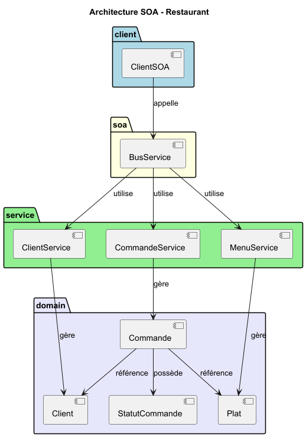
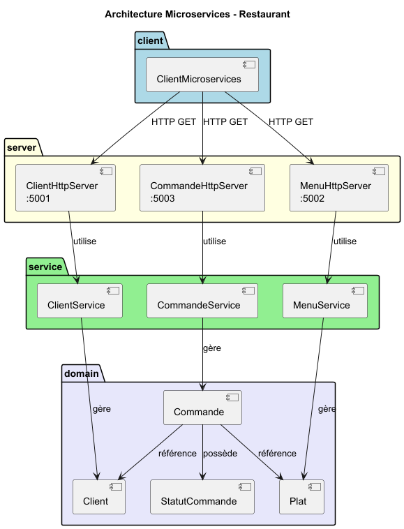

# 🍕 Restaurant — SOA vs Microservices (Java)


Une même application de gestion de restaurant (clients, plats, commandes) implémentée selon **deux styles architecturaux**, pour les comparer :

1. **SOA** : le client passe par un **bus de services** (`BusService`) qui orchestre les services, sans HTTP.
2. **Microservices** : trois services indépendants exposés en **HTTP**, appelés directement par le client.

> Travail pratique 2 — cours **420-A13 Conception et architecture logicielle** — Collège de Bois-de-Boulogne, AEC Analyste-programmeur, 2026.

---

## 📐 Diagrammes

| SOA | Microservices |
|---|---|
|  |  |

Sources PlantUML : [`DiagrammeSOA.puml`](src/uml/DiagrammeSOA.puml) · [`DiagrammeMicroservices.puml`](src/uml/DiagrammeMicroservices.puml)

## 📏 Règles métier

- Client **VIP actif** : frais de service 0,00 $ · client normal actif : 2,00 $ · client **inactif** : ne peut pas commander
- Plat **non disponible** : commande refusée
- **Promotion** appliquée sur le prix du plat (ex. 10 %)
- Statuts de commande : `CREEE`, `EN_PREPARATION`, `ANNULEE`, `TERMINEE`

## 📁 Structure

```
src/
├── domain/        Client, Plat, Commande, StatutCommande
├── service/       ClientService, MenuService, CommandeService   (version SOA)
├── bus/           BusService                                   (orchestrateur SOA)
├── microservice/  ServiceClient, ServiceMenu, ServiceCommande  (logique des microservices)
├── server/        ClientHttpServer :5001, MenuHttpServer :5002, CommandeHttpServer :5003
├── app/           ClientSOA, ClientMicroservices               (programmes de démonstration)
└── uml/           diagrammes PlantUML + PNG
```

## 🚀 Exécution (IntelliJ IDEA ou ligne de commande)

**Version SOA** : exécuter `app.ClientSOA`.

**Version microservices** :
1. Démarrer les trois serveurs : `server.ClientHttpServer`, `server.MenuHttpServer`, `server.CommandeHttpServer`
2. Exécuter `app.ClientMicroservices` (appels via `java.net.http.HttpClient`)

## 👩‍💻 Auteure

**Hanen Chtourou** — Analyste-programmeure
[LinkedIn](https://linkedin.com/in/hanen-chtourou-45097a104) · [GitHub](https://github.com/hanen91-ch)
